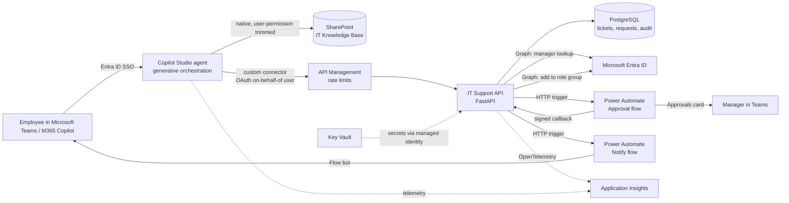
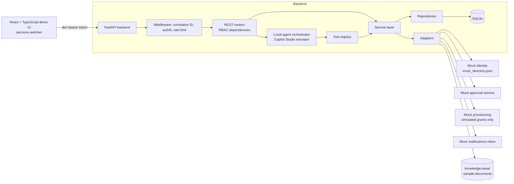
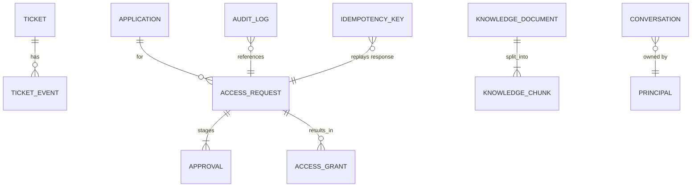

# Architecture

## 1. Target (tenant) architecture



## 2. Local (runnable) architecture



Every mock implements the same Python `Protocol` as its real counterpart and is selected by environment variables
in `app/container.py` (composition root):

| Port | Mock (local) | Real adapter (tenant) | Env var |
|---|---|---|---|
| Authentication | `MockTokenService` (HS256 dev tokens) | `EntraTokenValidator` (RS256/JWKS) | `AUTH_MODE` |
| Identity / manager | `MockIdentityProvider` | `GraphIdentityProvider` | `IDENTITY_PROVIDER` |
| Approvals | `MockApprovalProvider` | `PowerAutomateApprovalProvider` | `APPROVAL_PROVIDER` |
| Provisioning | `MockProvisioningProvider` | `EntraGroupProvisioningProvider` | `PROVISIONING_PROVIDER` (+ `ALLOW_REAL_PROVISIONING`) |
| Notifications | `MockNotificationProvider` | `TeamsFlowNotificationProvider` | `NOTIFICATION_PROVIDER` |
| Knowledge source | `LocalDirectorySource` | `SharePointGraphSource` | `KNOWLEDGE_SOURCE` |
| Embeddings | `LocalHashingEmbedder` | `AzureOpenAIEmbedder` | `EMBEDDING_PROVIDER` |
| Answer generation | `ExtractiveAnswerGenerator` | `AzureOpenAIAnswerGenerator` | `ANSWER_PROVIDER` |

## 3. Backend layering

```
app/
  api/            HTTP controllers + dependencies (DB unit of work, principal, RBAC)
  agents/         router (intent + slots), tool registry, orchestrator
  services/       business rules: tickets, access workflow, knowledge (RAG), audit, notifications, idempotency
  repositories/   all SQL (SQLAlchemy 2.0)
  models/         ORM models + Pydantic schemas (API contract)
  security/       authN (tokens), RBAC, redaction, prompt guard, rate limiter, secrets
  integrations/   adapters: identity, approvals, provisioning, notifications, sharepoint, llm, graph client
  observability/  JSON logging, OpenTelemetry, metrics registry, middleware
```

Rules: controllers never touch SQL; services never import FastAPI; adapters never touch the database; the agent
can only call tools, and tools only call services – so the agent has exactly the same permissions as the user.

## 4. Key design decisions

| Decision | Rationale |
|---|---|
| Deterministic rules in the API, language in the agent | LLM output is untrusted. Identity, approver resolution, self-approval, durations, duplicates and audit are enforced server-side regardless of what the agent sends. |
| No approve tool exposed to the agent | Removes an entire class of prompt-injection outcomes. Decisions only via authenticated approver or signed flow callback. |
| Approver resolved by backend, not by the flow | One tested implementation of approver policy (no self-approval, governance fallback, owner second stage). |
| Idempotency keys + duplicate-active-request check | Agents and connectors retry; retries must not create duplicate requests or approvals. |
| Hash-chained audit log | Cheap tamper evidence; verifiable via `/api/v1/audit/verify`. |
| Security trimming before scoring | Restricted chunks never enter the candidate set, so they cannot leak through answers, citations or scores. |
| Mock adapters behind the same interfaces | Full workflow demo without credentials; switching to real services is configuration, not code. |
| `ALLOW_REAL_PROVISIONING` safety switch | The app refuses to start with the real provisioning adapter unless explicitly enabled. |

## 5. Data model (simplified)


