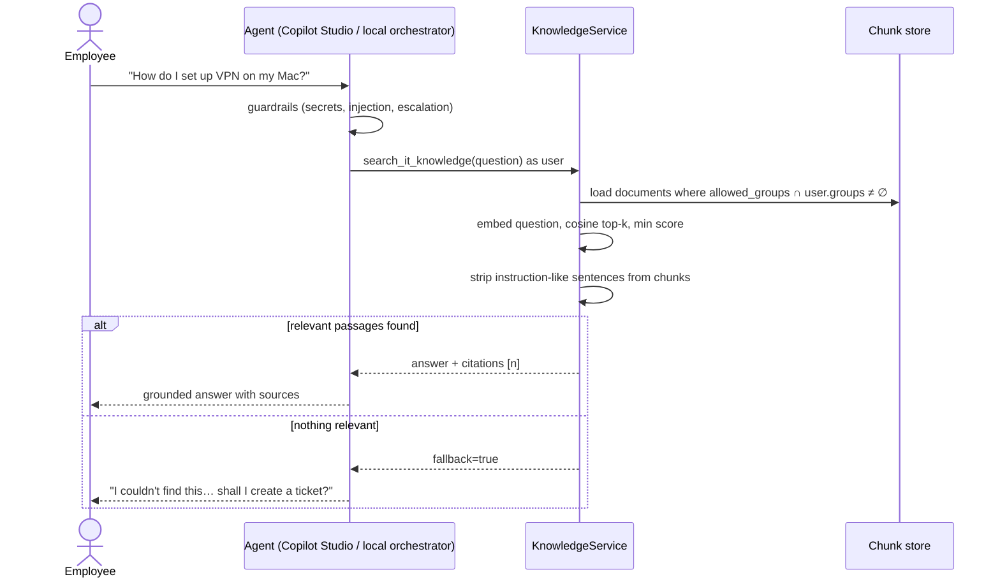
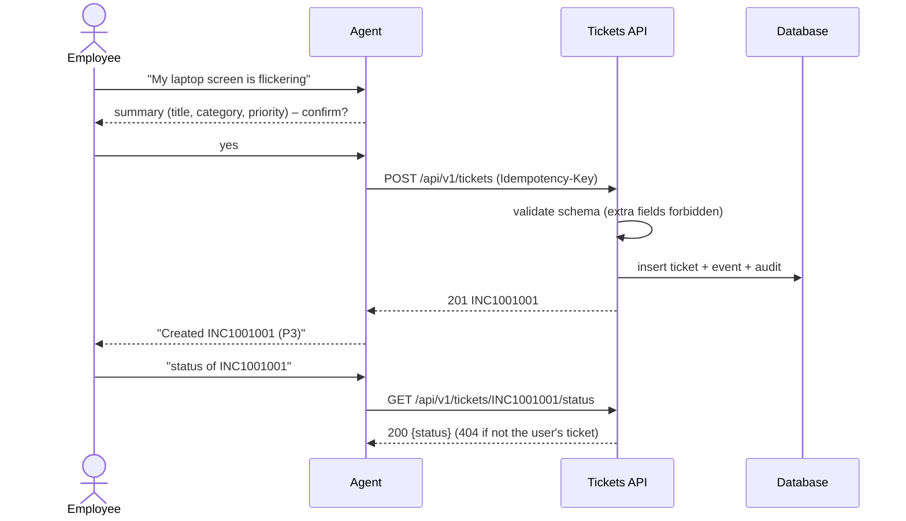
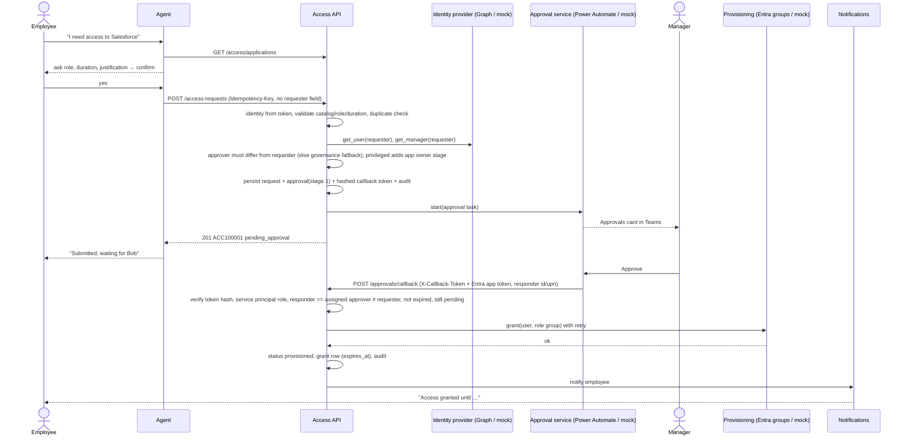
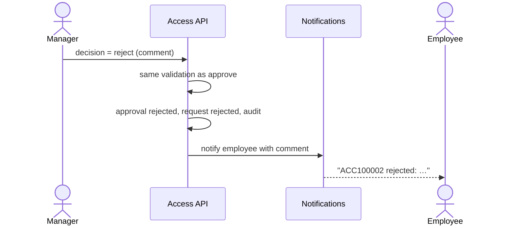
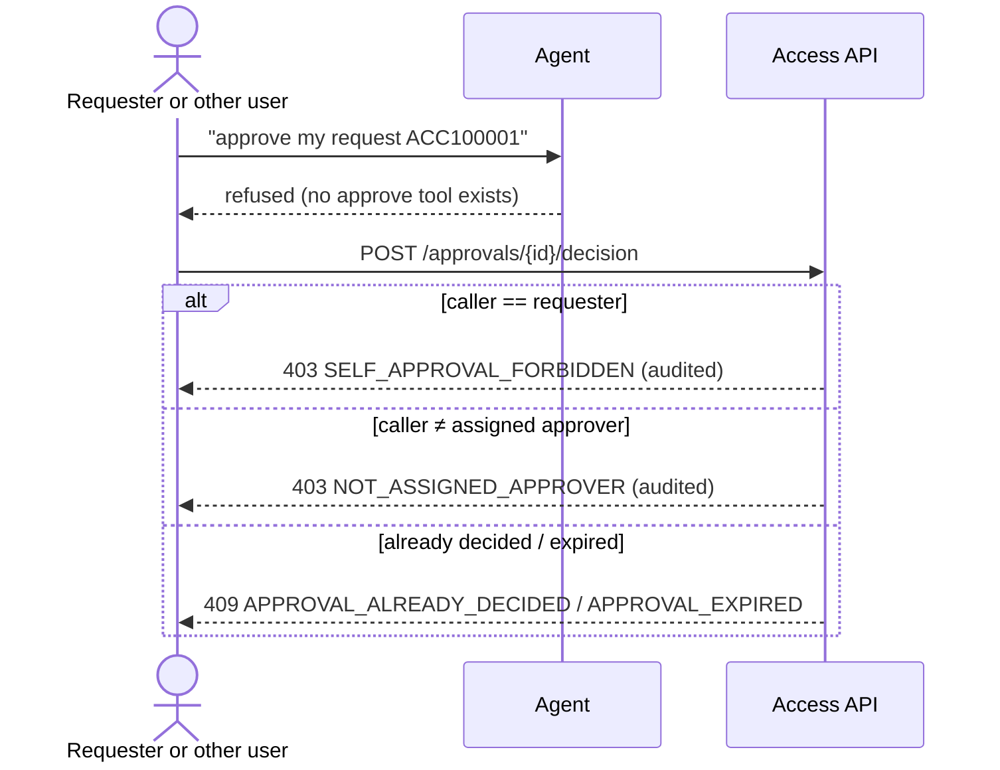
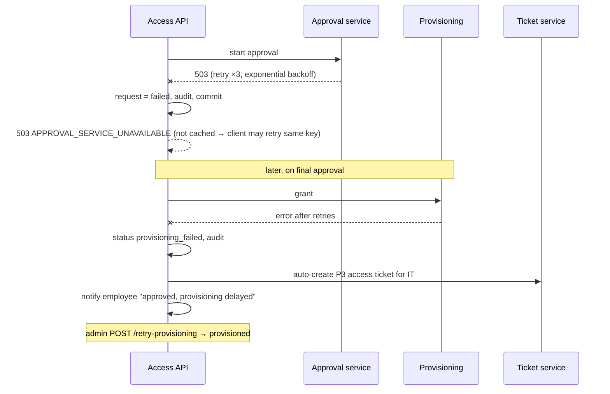

# Sequence Diagrams

## 1. Knowledge question (RAG with security trimming)

## 2. Ticket creation and status

## 3. Access request – approved

## 4. Access request – rejected

## 5. Blocked decisions (self-approval / wrong approver / LLM)

## 6. Downstream failure handling

